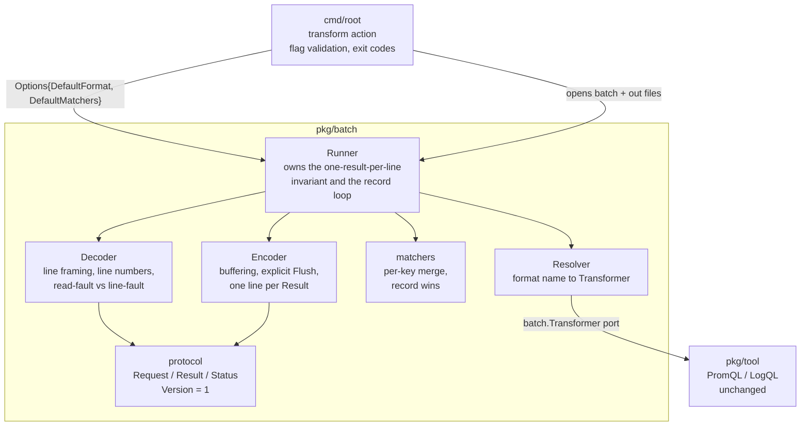
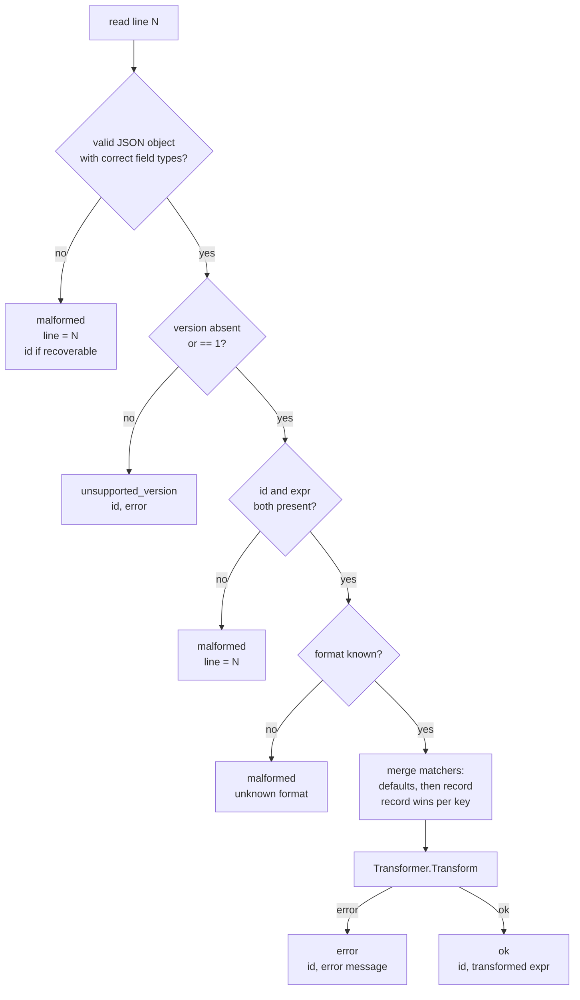
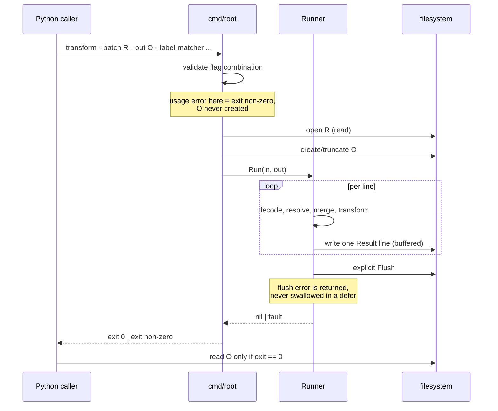

# Batch transform — interfaces and protocol

Detailed design for [ADR 0001](../adr/0001-batch-cli-mode-for-python-integration.md).
The user-facing contract is documented in [README.md](../../README.md#batch-transform);
this document defines the internal module boundaries and interfaces that satisfy it.

**Status:** implemented in `pkg/batch` and `cmd/root`. The interface
definitions below are the shapes that were built; see
[Open decisions](#open-decisions) for how each one was resolved, and
[Deviations from this design](#deviations-from-this-design) for where the
implementation knowingly departs from it.

## Contents

- [Scope](#scope)
- [Constraints discovered in the code](#constraints-discovered-in-the-code)
- [Module map](#module-map)
- [Interface contracts](#interface-contracts)
- [Per-record status assignment](#per-record-status-assignment)
- [Invocation lifecycle](#invocation-lifecycle)
- [Invariants](#invariants)
- [Rejected alternatives](#rejected-alternatives)
- [Open decisions](#open-decisions)
- [Deviations from this design](#deviations-from-this-design)
- [Implementation sequencing](#implementation-sequencing)
- [Measured throughput](#measured-throughput) — includes the
  [throughput target](#throughput-target) ADR 0001 deferred

## Scope

Implement the batch mode of `transform`:

```bash
cos-tool [--format promql|logql] transform \
    --batch requests.jsonl \
    --out results.jsonl \
    [--label-matcher juju_model=cos ...]
```

Success criteria, in priority order:

1. Exactly one JSONL result line per request line, in input order.
2. Exit zero **iff** cos-tool completed the batch. Per-expression failure is
   data in the results file, not exit status.
3. One bad line never costs the caller the other 49,999 results.
4. `transform --batch-version` prints `1`, exits zero, touches no files.
5. Single-expression `transform` behaviour is unchanged.

Out of scope (per ADR): concurrency within a batch, throughput targets,
caching/deduplication, per-item timeouts, streaming over pipes, batch modes for
`validate-rules` / `validate-config`.

## Constraints discovered in the code

These findings shape the design; each one is a trap worth knowing about before
writing code.

| #   | Finding                                                                                                                                                                                   | Consequence                                                                                                                                                                                               |
| --- | ----------------------------------------------------------------------------------------------------------------------------------------------------------------------------------------- | --------------------------------------------------------------------------------------------------------------------------------------------------------------------------------------------------------- |
| C1  | `Transform` stores per-call state on the receiver (`p.expr`, `p.matchers`, `p.sortedMatchers` in `pkg/tool/logql_transform.go`; `p.expr`, `p.matchers` in `pkg/tool/promql_transform.go`) | Sequential reuse of one instance is safe; each call overwrites. Concurrent use is **not**. The future-concurrency seam is "one transformer instance per worker", never "share one instance".              |
| C2  | `cmd/root` resolves exactly one `tool.Checker` into `context` under `implKey`                                                                                                             | The per-record `format` field cannot be served by that pattern. Batch mode needs a resolver holding both implementations.                                                                                 |
| C3  | `main.go` and the existing `transform` action use `log.Fatal`, which calls `os.Exit` and therefore **skips deferred flushes**                                                             | Batch code must never `log.Fatal`. Flush must be explicit and its error must be part of the returned error, not a best-effort `defer`. This is the likeliest way to silently violate success criterion 1. |
| C4  | The PromQL parser recovers runtime panics into `errUnexpected` and prints a 64KB stack trace to stderr; the LogQL parser recovers into a parse error                                      | Parser panics are already contained. Panics in cos-tool's own placeholder/restore code are **not**, and would abort the whole batch. See [open decision 1](#open-decisions).                              |
| C5  | `tool.GetLabelMatchers` splits on `=` and requires exactly two parts, so `--label-matcher k=a=b` is rejected                                                                              | The JSON `matchers` object has no such limit. Batch is strictly more expressive than the flag. Document; do not "fix".                                                                                    |
| C6  | `Transform` returns `(originalExpr, err)` on parse failure                                                                                                                                | On `status: "error"`, emit only `error`. Never echo the input back as `expr`.                                                                                                                             |
| C7  | `tool.Checker` bundles `Transform` + `ValidateRules` + `ValidateConfig`                                                                                                                   | Batch needs only `Transform`. A segregated `Transformer` interface keeps the new dependency honest.                                                                                                       |
| C8  | `Transform` takes `*map[string]string`                                                                                                                                                    | A pointer-to-map is a wart. Contain it at the boundary; keep it out of new public shapes.                                                                                                                 |

Conventions to match: `pkg/<area>` packages with the CLI as a thin shell;
external test packages (`package tool_test`); table-driven `t.Run` subtests with
`testify/assert`; shell-based integration tests over the dashboard corpus in
`tests/`.

## Module map

A new package `pkg/batch` owns the entire wire interface and the batch loop.
`cmd/root` stays a thin shell. `pkg/tool` is untouched apart from one additive
interface declaration.



Dependency direction is strictly downward. `pkg/tool` never learns about
batching; `pkg/batch` never learns about `urfave/cli`, file paths, or `os.Exit`.

| Module     | Owns                                                                                         | Does not own                                           |
| ---------- | -------------------------------------------------------------------------------------------- | ------------------------------------------------------ |
| `cmd/root` | Flag-combination validation, opening/truncating files, mapping `Run`'s error to an exit code | Any knowledge of JSONL, statuses, or versions          |
| `protocol` | Wire shapes, status vocabulary, `Version` constant                                           | I/O, decisions                                         |
| `Decoder`  | Framing, 1-based line numbers, distinguishing read fault from line fault                     | Deciding what a bad line _means_                       |
| `Encoder`  | Buffered writes, flush, exactly one line per `Result`                                        | Deciding what to write                                 |
| `matchers` | Per-key merge, record-wins                                                                   | Label-name validation (see [invariant 8](#invariants)) |
| `Resolver` | Holding one `Transformer` per format, lazily                                                 | Format _defaulting_ (that is `Options`)                |
| `Runner`   | The loop, status assignment, ordering, panic barrier                                         | File lifecycle, flag parsing                           |

## Interface contracts

### Protocol — `pkg/batch`

```go
// Version is the batch interface version this binary implements.
const Version = 1

// Request is one input line.
//
// Pointer fields distinguish "absent" from "present but empty". This is
// load-bearing: the contract promises `malformed` for a *missing* id or expr,
// which plain string fields cannot tell apart from an empty one.
type Request struct {
    ID       *string           `json:"id"`
    Expr     *string           `json:"expr"`
    Matchers map[string]string `json:"matchers,omitempty"`
    Format   *string           `json:"format,omitempty"`
    Version  *int              `json:"version,omitempty"`
}

// Status is the per-record outcome vocabulary.
type Status string

const (
    StatusOK                 Status = "ok"
    StatusError              Status = "error"
    StatusMalformed          Status = "malformed"
    StatusUnsupportedVersion Status = "unsupported_version"
)

// Result is one output line. Field order is the emitted JSON key order and
// matches the examples in README.md; keep it stable.
type Result struct {
    Version int     `json:"version"`
    ID      *string `json:"id,omitempty"`
    Line    int     `json:"line,omitempty"`
    Status  Status  `json:"status"`
    Expr    string  `json:"expr,omitempty"`
    Error   string  `json:"error,omitempty"`
}
```

Rules that are not visible in the struct tags:

- `Result.Version` is always **this binary's** `Version` — the version that
  produced the result — never the request's, including on
  `unsupported_version`. A results file is self-describing.
- `Result.ID` is a pointer so a caller who legitimately submits `"id": ""` gets
  `"id":""` echoed back, rather than the field vanishing under `omitempty`.
- Decoding must **not** set `DisallowUnknownFields`. Forward compatibility
  requires unrecognised fields to be ignored on both sides.
- `Expr` is set only on `StatusOK`; `Error` only on the three failure statuses.

### Port into `pkg/tool`

```go
// pkg/batch

// Transformer is the only capability batch mode needs from pkg/tool.
type Transformer interface {
    Transform(expr string, matchers *map[string]string) (string, error)
}

// Resolver maps a format name to its transformer.
//
// Returned instances are NOT safe for concurrent use (see constraint C1). If
// batch mode ever gains concurrency, each worker must get its own instance.
type Resolver interface {
    // Transformer returns the transformer for a format name, or ok=false for
    // an unrecognised name.
    Transformer(format string) (Transformer, bool)
}
```

Additive declaration in `pkg/tool/common.go`, satisfied today by `*PromQL` and
`*LogQL` with no change to either implementation:

```go
// pkg/tool

// Transformer is the expression-rewriting subset of Checker.
type Transformer interface {
    Transform(arg string, matchers *map[string]string) (string, error)
}
```

`Checker` keeps its current method set; no existing caller changes.

### Decoder

The read-fault / line-fault split is the heart of the exit-code contract: a
line fault is data, a read fault ends the batch.

```go
// Record is one decoded input line.
type Record struct {
    Line  int      // 1-based input line number
    Req   *Request // nil iff Fault != nil
    Fault error    // this line is not a request; recoverable, becomes `malformed`
}

type Decoder interface {
    // Next returns the next record, or ok=false at clean EOF or on read fault.
    Next() (rec Record, ok bool)

    // Err reports an I/O fault that means the batch cannot complete.
    // Nil after a clean EOF.
    Err() error
}
```

### Encoder

```go
type Encoder interface {
    // Encode writes exactly one line for one Result.
    Encode(res Result) error

    // Flush pushes buffered output to the underlying writer. Its error must be
    // propagated, never swallowed in a defer (see constraint C3).
    Flush() error
}
```

### Runner

```go
// Options carries the invocation-level defaults a batch runs under.
type Options struct {
    DefaultFormat   string            // from --format
    DefaultMatchers map[string]string // from --label-matcher
}

func NewRunner(opts Options, res Resolver) *Runner

// Run processes every line of in and writes one result line to out per input
// line, in input order.
//
// Run returns a non-nil error ONLY for faults that mean the batch did not
// complete: unreadable input, unwritable or unflushable output, internal
// fault. Every per-record outcome is a Result line, never an error return.
func (r *Runner) Run(in io.Reader, out io.Writer) error
```

`Run` takes `io.Reader` / `io.Writer` rather than paths, so the engine is
testable with in-memory buffers and file lifecycle stays in `cmd/root`.

### Matcher merge

```go
// Merge returns the effective matcher set for one record: defaults overlaid
// per key by record, with record winning on conflict.
//
// Neither input is modified. A record can override an inherited default but
// cannot remove one; see open decision 6 for the reserved `null` encoding.
func Merge(defaults, record map[string]string) map[string]string
```

### CLI surface

`transform` gains `--batch`, `--out`, and `--batch-version`. The order of
checks is contractual:

1. `--batch-version` — print `Version`, exit 0, open nothing.
2. Flag-combination check — usage error, exit non-zero, **create no file**.
3. Dispatch to batch mode or the existing single-expression mode.

| Invocation                                              | Outcome                       |
| ------------------------------------------------------- | ----------------------------- |
| `--batch-version`                                       | print `1`, exit 0             |
| `--batch` without `--out`, or `--out` without `--batch` | usage error, no file created  |
| `--batch` plus a positional expression                  | usage error, no file created  |
| `--batch` and `--out`                                   | batch mode                    |
| positional expression only                              | existing behaviour, unchanged |

`Before` in `cmd/root` should keep populating `implKey` so the
single-expression path is literally unchanged; batch mode builds a `Resolver`
instead of reading `implKey`.

## Per-record status assignment

Check order is a deliberate forward-compatibility decision: **version is
checked before v1's required-field rules**, so a future v2 record that omits a
field v1 requires is reported as `unsupported_version` (actionable) rather than
`malformed` (misleading).



Every branch terminates in exactly one `Result`. That is the invariant the
`Runner` exists to protect.

## Invocation lifecycle



### Failure cases

| Case                                       | Behaviour                                                    | Exit     |
| ------------------------------------------ | ------------------------------------------------------------ | -------- |
| Empty batch file                           | `--out` created, zero bytes written                          | 0        |
| Invalid JSON on line 7                     | `malformed` with `line: 7`; lines 8..N still processed       | 0        |
| Unparseable expression                     | `error` with the parse message; `expr` omitted               | 0        |
| `--batch` path unreadable                  | fail before writing any result; diagnostic on stderr         | non-zero |
| `--out` unwritable, or disk full mid-batch | abort; partial file left on disk for inspection              | non-zero |
| Flush fails at end                         | abort — the case `log.Fatal` would turn into a false success | non-zero |
| Transform panics on a record               | see [open decision 1](#open-decisions)                       | TBD      |
| `"version": 7`                             | `unsupported_version`, `id` echoed                           | 0        |
| `--batch-version` on a pre-batch binary    | urfave/cli rejects the unknown flag                          | non-zero |

## Invariants

1. **Line parity.** On exit 0, `wc -l results.jsonl == wc -l requests.jsonl`
   (modulo a single trailing newline on input). Mechanically checkable, and the
   best acceptance test available.
2. **Order.** Results appear in input order.
3. **Exit code means completion, not success.** Exit 0 implies every request was
   answered. Non-zero means the results file is unusable, not partial.
4. **No result data on stdout/stderr.** `--batch-version` is the only exception
   and writes only the version.
5. **Flush is part of the contract.** Unflushed output must surface as a
   non-zero exit, never as a short file with exit 0.
6. **Merge is per key and additive.** A record can override an inherited
   default; it cannot remove one.
7. **Forward compatibility.** Unknown fields are ignored; an unknown version is
   reported per record, never fatally.
8. **Known gap, consistent with today:** neither path validates that injected
   label _names_ are legal, so `{"matchers": {"not a label": "x"}}` yields
   output that does not re-parse. Pre-existing in the single-expression path;
   recommendation is to document rather than diverge.

## Rejected alternatives

Recorded so they are not re-derived during implementation.

**Where the batch logic lives.** Keeping it all in the `cmd/root` action makes
the one-result-per-line invariant only end-to-end testable and gives `root.go` a
second personality; putting it in `pkg/tool` makes that package both engine and
protocol. A separate `pkg/batch` makes the most important invariant cheap to
unit-test.

**Format resolution.** Keeping the single `implKey` implementation and rejecting
records whose `format` differs contradicts the mixed-format example already
documented in the README. Constructing a fresh transformer per record allocates
50,000 times for state that is overwritten on every call anyway.

**Required-field detection.** Decoding into `map[string]json.RawMessage` and
re-decoding needs two passes and hand-rolled type errors. Plain string fields
treating empty as missing cannot honour `"id": ""` and silently reinterpret
caller data.

**Line reading.** A streaming `json.Decoder` over the whole file is the tempting
default and is **wrong here**: one malformed line desynchronises the stream,
losing both per-line recovery and accurate line numbers — two documented
promises. `bufio.Scanner` with a raised cap turns any long line into a silent
correctness cliff with no good status to report. Hence a `bufio.Reader` reading
to the next newline with no artificial limit, then `json.Unmarshal` per line;
the final line may lack a trailing newline.

**Output durability.** Writing to a temp file and renaming atomically is
stronger, but contradicts the ADR's "leaves both files on disk for inspection"
debugging argument and changes the documented overwrite semantics. Buffered
in-place writing stands, per ADR; atomic rename remains a clean future
hardening if partial files prove confusing.

## Open decisions

All six were resolved during implementation, each toward the option this
document recommended. Summary first, reasoning below.

| #   | Decision                         | Resolution                                                    |
| --- | -------------------------------- | ------------------------------------------------------------- |
| 1   | Panic barrier per record         | (a) recover per record as `error`, announce on stderr         |
| 2   | Unknown `format` value           | `malformed`, listing the valid names; flag asymmetry accepted |
| 3   | Blank lines mid-file             | `malformed`; a single trailing newline is ignored             |
| 4   | `line` on non-`ok` results       | Reported on every failure; omitted on success                 |
| 5   | `--batch-version` with `--batch` | Short-circuits and prints, touching no files                  |
| 6   | `"matchers": {"k": null}`        | `malformed`; `null` stays reserved                            |

Decision 2's asymmetry was kept deliberately and is worth restating: an
unrecognised `--format` **flag** still falls back to PromQL, as it always has,
while an unrecognised per-record `format` is `malformed`. Tightening the flag
would be a breaking change to the existing single-expression path for no gain,
and failing the flag lazily would turn one typo into 50,000 malformed records.
The fallback is applied once, in `canonicalFormat`, so both paths agree on what
the default format is.

Decisions 2, 3, 4 and 6 each needed a README amendment; those edits were made.

1. **Panic barrier per record.** Constraint C4 means a panic in cos-tool's own
   placeholder/restore code would abort all 50,000 results. Options:
   (a) recover per record, emit `status: "error"` with a distinguishing message
   and log to stderr — the batch survives, but a _bug_ is reported using the
   vocabulary for _invalid input_;
   (b) no barrier, so a panic aborts with a non-zero exit — the literal reading
   of "exit status reflects whether the tool completed", at the cost of one
   pathological rule killing the cycle;
   (c) add a fourth `status: "internal"` to v1 — most precise, but widens the
   documented status vocabulary.
   Leaning (a), because surviving the batch is the ADR's strongest stated
   commitment and stderr already carries parser stack traces.
2. **Unknown `format` value** (e.g. `"sql"`) is covered by neither the README
   nor the ADR. Recommendation: `malformed`, which means widening the README's
   `malformed` description from "invalid JSON, missing `id` or `expr`, wrong
   types" to also cover invalid field _values_. Note the asymmetry: the global
   `--format` flag silently falls back to PromQL for unknown values, so records
   would be stricter than the flag. Accept the asymmetry, or tighten both?
3. **Blank lines mid-file.** Recommendation: a single trailing newline at EOF is
   ignored; any other empty or whitespace-only line is `malformed`. This is what
   makes invariant 1 mechanical.
4. **`line` on non-`ok` results.** The README specifies `line` only for
   `malformed`. Including it on `error` and `unsupported_version` too is
   strictly more useful and purely additive, but needs a README edit.
5. **`--batch-version` combined with `--batch`.** Short-circuit and print
   (simplest, recommended), or treat as a usage error?
6. **`"matchers": {"k": null}`.** Recommendation: `malformed`, which keeps JSON
   `null` free as the future "unset this inherited default" encoding. The
   alternative is coercing to an empty string, which spends that encoding.

## Deviations from this design

Four places where the implementation departs from the shapes above, each
because the design had overlooked something.

**`Record` gained a `RecoveredID` field.** The design gave `Record` only
`Line`, `Req` and `Fault`. But the contract says a malformed result carries the
`id` "when it could be recovered", and with those three fields alone there is
nowhere for a recovered id to live: a line that fails to decode has no `Req`.
The decoder now re-reads just the `id` from a failed line and reports it
separately.

**`Matchers` became a named type with its own `UnmarshalJSON`.** Rejecting a
null matcher value (decision 6) had no home in the design. Putting it on the
type keeps the rule next to the data and out of the decoder, and means it
applies anywhere a request is decoded.

**`Resolver` is injected rather than lazy.** The design proposed holding one
transformer per format, constructed lazily. Laziness buys nothing here: both
implementations are zero-value structs, so holding both costs nothing and
avoids a mutex. `MapResolver` takes the transformers from its caller, which
also keeps `pkg/batch` free of any `pkg/tool` import — the dependency arrow in
the module map now exists only in the test and the CLI.

**`Options` gained a `Diagnostics` writer.** The panic barrier has to put its
notice somewhere, and `pkg/batch` must not reach for `os.Stderr` itself; that
would make the behaviour untestable and smuggle process state into a library.
The CLI passes the app's error writer. Nil discards.

One thing the design asserted and the implementation confirmed: `*PromQL` and
`*LogQL` satisfy the `Transformer` port with no change to `pkg/tool` beyond
declaring the interface. `Checker` now embeds it rather than redeclaring
`Transform`, so the two cannot drift.

## Implementation sequencing

Each step is independently verifiable.

1. **Protocol types and `Version`.** Tests: encode/decode round-trip; exact JSON
   key order against the README's example lines; absent vs. empty `id`/`expr`;
   unknown fields ignored.
2. **`Decoder`.** Tests: lines longer than any `bufio.Scanner` default; final
   line with no trailing newline; a malformed line followed by good lines;
   line numbering; an I/O fault surfacing via `Err()` rather than as a `Fault`.
3. **`Encoder` with explicit `Flush`.** Test: a failing writer surfaces as an
   error rather than a short file.
4. **`Merge`.** Table-driven: empty defaults, empty record, override, disjoint
   union, neither side mutated.
5. **`Resolver` plus the additive `tool.Transformer`.** Confirm `*PromQL` and
   `*LogQL` satisfy it with zero changes to `pkg/tool`.
6. **`Runner`.** The [status assignment](#per-record-status-assignment) flow
   becomes the test table directly, plus the parity invariant over a generated
   10k-line fixture.
7. **`cmd/root` wiring.** Three flags; the [CLI surface](#cli-surface) table is
   the test matrix. Assert `--out` is **not** created on usage errors, and that
   the single-expression path is unchanged.
8. **Integration acceptance.** Extend `tests/integration/` to emit every
   expression from `tests/testdata/dashboards/` as one JSONL batch, then assert
   line parity and a per-status tally. This reuses the existing corpus and
   `extract_expressions.jq`, and is the closest available proxy for the real
   50k workload.
9. **Benchmark.** ADR 0001 explicitly owes one: "absolute throughput ... must be
   benchmarked once implemented, and a target set from those numbers." A
   `Runner`-level Go benchmark over a synthetic 50k batch settles that debt and
   belongs in this change rather than a follow-up.

All nine steps are implemented. Step 8 runs as part of `make test-integration`.

## Measured throughput

All figures from an Apple M2. Two benchmarks, answering two different
questions.

### Transformation work, in process

The number ADR 0001 asked for, from `BenchmarkRunner`: 50,000 PromQL
expressions with per-record matchers.

```bash
go test ./pkg/batch/ -run '^$' -bench . -benchmem
```

```
BenchmarkRunner-8   3   752596653 ns/op   9.84 MB/s   265612064 B/op   5152155 allocs/op
```

So roughly **0.75 seconds** for a 50,000-expression cycle, about 15µs per
expression. Spawn overhead was the whole problem and it is gone; per-expression
work is now the only cost, and it is small.

### Batch versus consecutive invocation, measured

The comparison the ADR's argument rests on, and which nothing in the repository
checked until now: the ~20ms spawn cost and the ~1,000s total were quoted from
a measurement taken outside the project. `BenchmarkSpawnComparison` in
`cmd/root` runs both strategies over identical input, spawning real processes,
because an in-process benchmark cannot see spawn overhead at all.

```bash
make bench
```

200 expressions, same expressions and same matchers on both sides. Ranges are
across several runs, because the spawning side is noisier than the in-process
benchmark:

|                                | Total      | Per expression |
| ------------------------------ | ---------- | -------------- |
| Consecutive (one process each) | 2.0-2.8s   | 9.9-13.8ms     |
| Batch (one process)            | 23-33ms    | 115-165µs      |
| **Speedup**                    | **60-88x** |                |

One no-op invocation (`transform --batch-version`) costs **~10-17ms**, which
brackets the ADR's ~20ms estimate and confirms spawn dominates: essentially all
of the per-expression consecutive cost is process startup, not transformation.

Projected to the ADR's 50,000-expression cycle, charging batch mode its single
fixed spawn plus its marginal 50-110µs per expression:

|             | Projected     |
| ----------- | ------------- |
| Consecutive | **~8-11min**  |
| Batch       | **~2.5-5.5s** |
| Saved       | ~8-11min      |

The ADR predicted ~1,000s of pure overhead; the measurement says ~500-660s on
this hardware. Same order, same conclusion.

Note the two batch projections differ (~2.5-5.5s here, ~0.72s above) because
this one includes JSON encode/decode, file I/O, and process startup, where
`BenchmarkRunner` isolates transformation. The larger figure is the one a caller
actually experiences.

These benchmarks are slow by construction — the consecutive case pays 200
process spawns — so they are not part of `make test`, which Go's default
behaviour already ensures. They warm the binary with one throwaway invocation
first: on macOS the first exec of a freshly built binary pays code-signature
validation and page-cache costs that showed up as a 20x outlier on the first
measured iteration. Those costs are real but are paid once per deployment, not
once per batch.

### Throughput target

ADR 0001 deferred this: "Absolute throughput of the resulting batch mode should
be measured once implemented, and a target set then — informed by real numbers
rather than estimates." The numbers now exist, so:

> **Target: `transform --batch` processes 50,000 expressions in under 30
> seconds, end to end, including process start and file I/O.**

That is roughly **6x headroom** over the measured 2.5-5.5s. The headroom is
the point, and it is deliberately generous:

- The measurement is on an Apple M2. cos-tool ships for linux/amd64, arm64,
  ppc64le and s390x, and runs inside Juju hook execution on contended machines
  that may be far slower than a developer laptop.
- Real expressions are longer and more varied than the synthetic ones
  benchmarked here, and real batches mix PromQL and LogQL.
- A target that tracks the current implementation too closely becomes a
  tripwire for unrelated changes, which trains people to raise the number
  rather than investigate.

A target is only worth stating if breaching it means something, so: **crossing
30s indicates a real regression and should be investigated, not raised.** At
6x headroom the plausible causes are algorithmic — accidental quadratic
behaviour in matcher merging or placeholder restoration, or per-record work
that should have been hoisted out of the loop — rather than gradual drift.

The secondary figure worth watching, because it isolates cos-tool's own work
from platform noise: **`BenchmarkRunner` under 5 seconds** for the same 50,000
expressions, against ~0.72s measured. Same reasoning, same 6x-ish headroom.

Deliberately _not_ targeted:

- **Per-expression latency.** Batch mode exists to amortise a fixed cost; a
  per-item bound would reintroduce exactly the load-dependence the ADR rejected
  when it declined per-item timeouts.
- **Allocation count.** At ~5.2M allocations for 50,000 expressions (~103 per
  expression) the transform path allocates heavily, but that is pre-existing
  `pkg/tool` behaviour that batch mode merely exposes at volume. It is the
  obvious first place to look if this ever needs to be faster; it is not a
  commitment. Note the ~265MB/op figure is total allocation across a run, not
  resident size — peak memory stays bounded by the largest single record, as
  intended.

Given these results, the concurrency-within-a-batch option the ADR left open
looks unnecessary. Recommend not pursuing it without a concrete workload that
proves otherwise.

Compatibility: additive only. No change to `validate-rules`,
`validate-config`, the single-expression path, or `Checker`'s method set.
`encoding/json` and `bufio` suffice — nothing new in `go.mod`.
